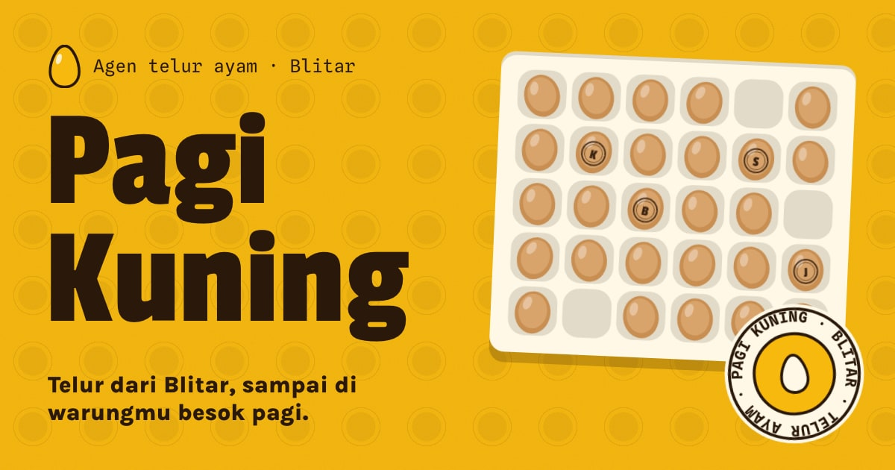

# Pagi Kuning — Telur ayam dari Blitar

Website company profile demo untuk paket **Standar UMKM** PintuWeb (Home, Profil, Layanan atau Produk, Blog, dan Kontak). Pagi Kuning adalah peternak dan agen telur ayam fiktif dari Blitar yang menjual telur per tray dan per peti ke warung, toko kue, dan katering. Ciri khasnya: setiap bagian halaman disusun di atas baki telur 30 lubang (6 kolom x 5 baris), ukuran telur ditandai cap huruf di cangkang, dan daftar harganya ditulis per tray, per butir, dan per peti.

**Demo live:** https://profil-telur.pintuweb.id



> Pagi Kuning adalah usaha fiktif. Nama, alamat, jam kerja, area kirim, harga, tanda naik atau turun harga, dan tulisannya semuanya rekaan. Harga di situs ini hanya contoh dan bukan harga pasar. Tidak ada nomor telepon, email, atau peta sungguhan. Formulir kontak hanya menyusun pesan WhatsApp di browser pengunjung (tautan `wa.me` tanpa nomor): tidak ada data yang dikirim ke server.

## Yang diperlihatkan

Lima halaman isi paket:

- **Beranda** (`/`): baki pembuka 6 x 5 (judul, foto, empat ukuran bercap, batas pesan 15.00), kemasan tray dan peti, bagan jadwal sehari (muat, antar, ambil sendiri, batas pesan), area kirim dengan peta arah, dan tiga tulisan terbaru.
- **Profil** (`/profil`): jalur telur dari kandang sampai tray, tiga hal yang dipegang, dan cara pesan.
- **Produk** (`/produk`): empat ukuran (kecil, sedang, besar, jumbo) dengan penggaris berat per butir dan perkiraan berat satu tray, kemasan tray 30 butir dan peti 6 tray, telur retak untuk usaha kue, dan cara kirim.
- **Kabar** (`/kabar`, `/kabar/<slug>`): tiga tulisan contoh: cara menyimpan telur di warung, arti ukuran telur di daftar harga (dengan tabel contoh hitungan), dan menghitung kebutuhan telur katering.
- **Kontak** (`/kontak`): formulir yang menyusun pesan WhatsApp (nama, jenis usaha, jumlah per ukuran dalam tray atau peti, tujuan, cara terima, hari kirim, catatan) dengan pratinjau pesan, pemeriksaan pesanan minimum per area, tombol salin pesan, serta alamat gudang contoh, jam kerja, dan area kirim.

Halaman tambahan:

- **Daftar harga** (`/harga`): papan harga contoh yang disusun di atas kisi baki 30 lubang: harga per tray, per butir, dan per peti untuk tiap ukuran, tanda naik atau turun dibanding kemarin (contoh), batas pesan untuk kirim besok, pesanan minimum dan area kirim, telur retak, serta tombol WhatsApp. Label "Contoh harga, bukan harga pasar" selalu tampil, dan tidak ada tanggal tetap: harga diperbarui tiap pagi lewat WhatsApp.

Lainnya: JSON-LD `WholesaleStore` (tanpa telepon, rating, atau ulasan), `BreadcrumbList` di halaman dalam, `BlogPosting` di tulisan, `robots.txt`, `sitemap.xml`, ikon, gambar bagikan 1200 x 630, dan halaman tidak ditemukan bergaya telur pecah.

## Identitas visual

- **Huruf:** Passion One (judul dan angka besar), Karla (teks), Spline Sans Mono (label, satuan, dan angka kecil). Semua lewat `next/font`, variabel dipasang di `<html>`.
- **Warna:** kuning telur (dominan), krem cangkang, dan cokelat tua; karton tray sebagai warna pendamping. Kuning dipakai sebagai latar dengan teks cokelat, cokelat sebagai latar dengan teks kuning atau krem, sehingga kontrasnya lolos AA.
- **Motif:** baki 30 lubang sebagai dasar tata letak bento (setiap bagian adalah lubang yang menempati satu atau beberapa sel, bibir atasnya lebih gelap supaya terlihat melesak), cap huruf ukuran dengan tepi tinta yang digoyang filter SVG, serat bubur kertas karton, dan telur yang "turun" ke lubangnya saat halaman dibuka (mati bila `prefers-reduced-motion`).
- **Gambar:** tujuh foto CC0 (telur, tray, kandang, nasi kuning) tanpa orang, dan ilustrasi SVG buatan sendiri (telur, baki, penggaris, kendaraan antar, peta arah). Sumber tiap gambar ada di [`public/images/SUMBER.md`](public/images/SUMBER.md).

## Model data

- `lib/data.js`: `site`, `jam`, `MENU`, `ukuran` (rentang berat, harga contoh per tray, perubahan contoh, perkiraan berat tray), `retak`, harga per butir dan per peti (`hargaButir`, `hargaPeti`), `area` dan `tujuan` (pesanan minimum), `jadwal`, `kemasan`, `proses`, `prinsip`, `pelanggan`, dan pesan WhatsApp. Satu sumber untuk semua halaman, JSON-LD, dan formulir.
- `lib/kabar.js`: tulisan contoh berupa daftar blok (paragraf, judul, daftar, tabel berlabel); hitungan di tabel dihitung dari angka yang sama.
- `lib/seo.js`: metadata Open Graph per halaman dan data terstruktur. `lib/format.js`: format Rupiah dan tanggal tanpa bergantung pada data locale.

## Teknologi

- Next.js 15.5 (App Router) dan React 19, JavaScript dengan alias `@/`
- Tailwind CSS v4 (`@theme static` di `app/globals.css`)
- Gambar statis tanpa Image Optimization: varian WebP di `public/_img/` lewat `image-loader.js`. Setelah mengganti foto di `public/images`: `node scripts/static-images.mjs . --dirs public/images`

## Menjalankan secara lokal

```bash
npm install
npm run dev
```

Build produksi: `npm run build` lalu `npm start`. Pemeriksaan kode: `npm run lint`.

## Kredit foto

Foto berlisensi CC0 1.0; daftar lengkap ada di [`public/images/SUMBER.md`](public/images/SUMBER.md).

---

Dibuat oleh [PintuWeb](https://www.pintuweb.id), jasa pembuatan website.
